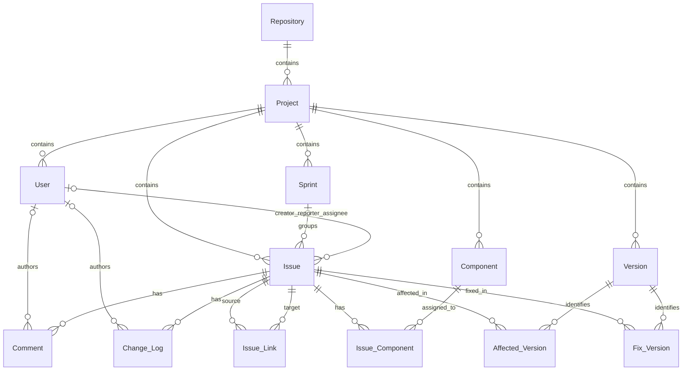

# Словарь данных TAWOS 1.1

Документ описывает фактическую структуру базы `tawos`, развёрнутой из
`data/raw/tawos/TAWOS.sql`: назначение таблиц, поля, типы, ключи, связи и
русские эквиваленты категориальных значений.

> Переводы приведены для чтения и анализа. Значения в самой базе остаются на
> английском; в SQL-запросах необходимо использовать исходные имена и строки.

## 1. Общая модель

Центральная сущность — `Issue` (задача Jira). Задача принадлежит проекту,
может входить в спринт, иметь создателя, автора сообщения о проблеме и
исполнителя. Комментарии и журнал изменений образуют историю задачи.
Компоненты и версии связаны с задачами через промежуточные таблицы.



### Состав базы

Точные количества строк в локальном экземпляре на 12 августа 2026 года:

| Таблица | Перевод / назначение | Строк |
|---|---|---:|
| `Repository` | источник — публичный Jira-репозиторий | 12 |
| `Project` | программный проект | 39 |
| `Issue` | задача, ошибка или запрос Jira | 458 232 |
| `Sprint` | итерация разработки | 4 594 |
| `User` | обезличенный участник проекта | 206 162 |
| `Comment` | комментарий к задаче | 1 518 327 |
| `Change_Log` | изменение атрибута задачи | 9 253 419 |
| `Component` | компонент программного продукта | 2 001 |
| `Version` | версия продукта | 6 911 |
| `Issue_Component` | связь задач и компонентов | 366 922 |
| `Affected_Version` | версия, затронутая проблемой | 264 004 |
| `Fix_Version` | версия, содержащая исправление | 224 254 |
| `Issue_Link` | направленная связь между задачами | 246 587 |

## 2. Условные обозначения и особенности

- `PK` — первичный ключ, `FK` — внешний ключ.
- `ID` — внутренний идентификатор TAWOS; `Jira_ID`/`JiraID` — идентификатор
  объекта в исходном Jira.
- Все даты и время нормализованы в UTC.
- Почти все поля допускают `NULL`. Он означает отсутствие или неприменимость
  значения, а не ноль и не пустую строку.
- `tinyint` в полях-флагах следует читать как логическое значение:
  `0` — «нет», `1` — «да», `NULL` — «неизвестно/неприменимо».
- В промежуточных таблицах нет первичного или уникального ключа. Поэтому при
  подсчёте сущностей безопаснее применять `COUNT(DISTINCT ...)` и проверять
  возможные повторы пар идентификаторов.
- `KEY` в DDL означает обычный неуникальный индекс, а не ограничение
  уникальности.

## 3. Таблицы и атрибуты

### `Repository` — репозиторий-источник

Публичная Jira-инсталляция или организация, из которой собраны проекты.

| Поле | Тип | NULL | Русская расшифровка |
|---|---|:---:|---|
| `ID` | `int` | нет | PK, внутренний идентификатор репозитория |
| `Name` | `varchar(512)` | да | название репозитория/организации |
| `Description` | `varchar(2048)` | да | описание источника |
| `URL` | `varchar(512)` | да | адрес исходного Jira-репозитория |

### `Project` — проект

| Поле | Тип | NULL | Русская расшифровка |
|---|---|:---:|---|
| `ID` | `int` | нет | PK, внутренний идентификатор проекта |
| `Project_Key` | `varchar(128)` | да | короткий ключ Jira, например `MESOS` |
| `Name` | `varchar(512)` | да | название проекта |
| `URL` | `varchar(512)` | да | адрес проекта в Jira |
| `Description` | `varchar(2048)` | да | описание проекта |
| `Start_Date` | `datetime` | да | дата начала/самого раннего события проекта |
| `Last_Update_Date` | `datetime` | да | дата последнего обновления проекта |
| `SP_Field_ID` | `varchar(45)` | да | Jira ID пользовательского поля Story Point |
| `Repository_ID` | `int` | да | FK → `Repository.ID`, источник проекта |

### `Issue` — задача Jira

Главная таблица. Одна строка описывает одну задачу, ошибку, историю,
улучшение или другой элемент Jira.

| Поле | Тип | NULL | Русская расшифровка |
|---|---|:---:|---|
| `ID` | `int` | нет | PK, внутренний идентификатор задачи |
| `Jira_ID` | `int` | да | числовой ID задачи в исходной Jira |
| `Issue_Key` | `varchar(512)` | да | человекочитаемый ключ, например `MESOS-123` |
| `URL` | `varchar(512)` | да | адрес исходной задачи |
| `Title` | `varchar(512)` | да | заголовок / краткое содержание |
| `Description` | `mediumtext` | да | исходное описание: текст вместе с кодом |
| `Description_Text` | `mediumtext` | да | выделенная естественно-языковая часть описания |
| `Description_Code` | `mediumtext` | да | выделенные фрагменты кода и трассировки стека |
| `Type` | `varchar(128)` | да | тип задачи; словарь см. ниже |
| `Priority` | `varchar(128)` | да | приоритет; словарь см. ниже |
| `Status` | `varchar(128)` | да | текущее состояние в workflow Jira |
| `Resolution` | `varchar(128)` | да | итог/способ закрытия задачи |
| `Creation_Date` | `datetime` | да | дата и время создания |
| `Estimation_Date` | `datetime` | да | момент первого заполнения Story Point |
| `Resolution_Date` | `datetime` | да | дата и время разрешения/закрытия |
| `Last_Updated` | `datetime` | да | дата последнего обновления |
| `Story_Point` | `double` | да | оценка сложности/трудоёмкости в story points |
| `Timespent` | `double` | да | исходное Jira-поле затраченного времени, в секундах |
| `In_Progress_Minutes` | `double` | да | время реализации в состоянии «в работе», минуты |
| `Total_Effort_Minutes` | `double` | да | полное время разработки с ревью и тестированием, минуты |
| `Resolution_Time_Minutes` | `double` | да | интервал от первого `In Progress` до `Resolved`, минуты |
| `Title_Changed_After_Estimation` | `tinyint` | да | менялся ли заголовок после первоначальной оценки |
| `Description_Changed_After_Estimation` | `tinyint` | да | менялось ли описание после первоначальной оценки |
| `Story_Point_Changed_After_Estimation` | `tinyint` | да | менялась ли оценка Story Point после её задания |
| `Pull_Request_URL` | `varchar(512)` | да | адрес связанного pull request |
| `Creator_ID` | `int` | да | FK → `User.ID`, создатель задачи |
| `Reporter_ID` | `int` | да | FK → `User.ID`, автор сообщения о проблеме |
| `Assignee_ID` | `int` | да | FK → `User.ID`, назначенный исполнитель |
| `Project_ID` | `int` | да | FK → `Project.ID`, проект |
| `Sprint_ID` | `int` | да | FK → `Sprint.ID`, спринт |

`Description_Text` и `Description_Code` получены автоматически из
`Description`. Разделение зависит от разметки кода в Jira и не гарантирует
идеальную классификацию каждого фрагмента. Персональные данные в текстах
заменены маркерами `<USER>` и `<EMAIL>`.

### `Sprint` — спринт

| Поле | Тип | NULL | Русская расшифровка |
|---|---|:---:|---|
| `ID` | `int` | нет | PK, внутренний идентификатор спринта |
| `JiraID` | `int` | да | ID спринта в исходной Jira |
| `Name` | `varchar(512)` | да | название спринта |
| `State` | `varchar(512)` | да | состояние спринта |
| `Start_Date` | `datetime` | да | плановая/фактическая дата начала |
| `End_Date` | `datetime` | да | плановая дата окончания |
| `Activated_Date` | `datetime` | да | дата активации |
| `Complete_Date` | `datetime` | да | дата завершения |
| `Project_ID` | `int` | да | FK → `Project.ID`, проект |

Значения `State`: `ACTIVE` — активен; `CLOSED` — завершён; `FUTURE` — будущий,
ещё не начатый.

### `User` — обезличенный пользователь

| Поле | Тип | NULL | Русская расшифровка |
|---|---|:---:|---|
| `ID` | `int` | нет | PK, сгенерированный TAWOS ID участника |
| `Project_ID` | `int` | да | FK → `Project.ID`, проект участника |

Идентификатор не совпадает с ID пользователя в исходной Jira. Имя, email и
другие персональные атрибуты намеренно отсутствуют.

### `Comment` — комментарий

| Поле | Тип | NULL | Русская расшифровка |
|---|---|:---:|---|
| `ID` | `int` | нет | PK, идентификатор комментария |
| `Comment` | `mediumtext` | да | исходный комментарий: текст вместе с кодом |
| `Comment_Text` | `mediumtext` | да | выделенная естественно-языковая часть |
| `Comment_Code` | `mediumtext` | да | выделенные код и трассировки стека |
| `Creation_Date` | `datetime` | да | дата публикации комментария |
| `Author_ID` | `int` | да | FK → `User.ID`, автор |
| `Issue_ID` | `int` | да | FK → `Issue.ID`, задача |

### `Change_Log` — журнал изменений

Одна строка — одно изменение одного поля задачи.

| Поле | Тип | NULL | Русская расшифровка |
|---|---|:---:|---|
| `ID` | `int` | нет | PK, идентификатор изменения |
| `Field` | `varchar(512)` | да | имя изменённого поля Jira |
| `From_Value` | `mediumtext` | да | прежнее внутреннее/машинное значение |
| `To_Value` | `mediumtext` | да | новое внутреннее/машинное значение |
| `From_String` | `mediumtext` | да | прежнее отображаемое значение |
| `To_String` | `mediumtext` | да | новое отображаемое значение |
| `Change_Type` | `varchar(512)` | да | укрупнённая категория изменения |
| `Creation_Date` | `datetime` | да | дата и время изменения |
| `Author_ID` | `int` | да | FK → `User.ID`, автор изменения |
| `Issue_ID` | `int` | да | FK → `Issue.ID`, изменённая задача |

Значения `Change_Type`:

| Значение | Перевод | Что входит |
|---|---|---|
| `STATUS` | статус | переходы workflow |
| `DESCRIPTION` | описание | заголовок или описание задачи |
| `PEOPLE` | участники | исполнитель или автор сообщения |
| `STORY_POINT` | оценка Story Point | изменение оценки |
| `OTHER` | прочее | остальные поля Jira |

В `Field` встречаются сотни системных и пользовательских полей разных Jira,
поэтому это открытый, проектно-зависимый справочник, а не единый enum.

### `Component` — компонент продукта

| Поле | Тип | NULL | Русская расшифровка |
|---|---|:---:|---|
| `ID` | `int` | нет | PK, внутренний идентификатор компонента |
| `Jira_ID` | `int` | да | ID компонента в исходной Jira |
| `Name` | `varchar(512)` | да | название компонента |
| `Description` | `varchar(512)` | да | описание компонента |
| `Project_ID` | `int` | да | FK → `Project.ID`, проект |

### `Issue_Component` — задача ↔ компонент

Реализует связь многие-ко-многим.

| Поле | Тип | NULL | Русская расшифровка |
|---|---|:---:|---|
| `Issue_ID` | `int` | да | FK → `Issue.ID`, задача |
| `Component_ID` | `int` | да | FK → `Component.ID`, компонент |

### `Version` — версия продукта

| Поле | Тип | NULL | Русская расшифровка |
|---|---|:---:|---|
| `ID` | `int` | нет | PK, внутренний идентификатор версии |
| `Jira_ID` | `int` | да | ID версии в исходной Jira |
| `Name` | `varchar(512)` | да | название/номер версии |
| `Description` | `varchar(2048)` | да | описание версии |
| `Archived` | `tinyint` | да | архивирована ли версия: `0` — нет, `1` — да |
| `Released` | `tinyint` | да | выпущена ли версия: `0` — нет, `1` — да |
| `Release_Date` | `datetime` | да | дата выпуска |
| `Project_ID` | `int` | да | FK → `Project.ID`, проект |

### `Affected_Version` — задача ↔ затронутая версия

Версия, в которой обнаружена ошибка или проявляется проблема.

| Поле | Тип | NULL | Русская расшифровка |
|---|---|:---:|---|
| `Issue_ID` | `int` | да | FK → `Issue.ID`, задача |
| `Affected_Version_ID` | `int` | да | FK → `Version.ID`, затронутая версия |

### `Fix_Version` — задача ↔ исправляющая версия

Версия, в которой выпущена функция или исправлена ошибка.

| Поле | Тип | NULL | Русская расшифровка |
|---|---|:---:|---|
| `Issue_ID` | `int` | да | FK → `Issue.ID`, задача |
| `Fix_Version_ID` | `int` | да | FK → `Version.ID`, версия исправления |

### `Issue_Link` — связь между задачами

| Поле | Тип | NULL | Русская расшифровка |
|---|---|:---:|---|
| `ID` | `int` | нет | PK, идентификатор связи |
| `Issue_ID` | `int` | да | FK → `Issue.ID`, исходная задача |
| `Name` | `varchar(512)` | да | тип/семейство связи |
| `Description` | `varchar(2048)` | да | словесное направление связи, например `duplicates` |
| `Direction` | `varchar(45)` | да | направление относительно `Issue_ID` |
| `Target_Issue_ID` | `int` | да | FK → `Issue.ID`, целевая задача |

`Direction`: `OUTBOUND` — исходящая, от `Issue_ID` к `Target_Issue_ID`;
`INBOUND` — входящая к `Issue_ID`. Смысл следует читать вместе с
`Description`: например, `Duplicate` + `duplicates` — «дублирует», а
`Duplicate` + `is duplicated by` — «дублируется задачей».

## 4. Словари категориальных значений

Значения Jira не унифицированы между репозиториями: одинаковый смысл может
иметь разные английские названия. Перевод ниже помогает интерпретации, но не
задаёт новую нормализованную классификацию.

### `Issue.Type` — тип задачи (полный список)

| Исходное значение | Русский эквивалент |
|---|---|
| `Bug` | ошибка / дефект |
| `Suggestion` | предложение |
| `Improvement` | улучшение |
| `Story` | пользовательская история |
| `Task` | задача |
| `Sub-task` | подзадача |
| `New Feature` | новая функция |
| `Epic` | эпик |
| `Enhancement Request` | запрос на улучшение |
| `Support Request` | запрос в поддержку |
| `Build Failure` | сбой сборки |
| `Question` | вопрос |
| `Technical task` | техническая задача |
| `Documentation` | документация |
| `Test Task` | тестовая задача |
| `Problem Ticket` | заявка о проблеме |
| `Wish` | пожелание |
| `Milestone` | контрольная точка |
| `Technical Debt` | технический долг |
| `Investigation` | исследование |
| `Incident` | инцидент |
| `Test` | тест |
| `Release` | выпуск |
| `Public Security Vulnerability` | публичная уязвимость безопасности |

### `Issue.Priority` — приоритет (полный список)

| Исходное значение | Русский эквивалент |
|---|---|
| пустая строка / `NULL` | приоритет не задан |
| `Blocker`, `Blocker - P1`, `Highest` | блокирующий / наивысший |
| `Critical`, `Critical - P2` | критический |
| `Major`, `Major - P3`, `High` | высокий / серьёзный |
| `Medium` | средний |
| `Minor`, `Minor - P4`, `Low` | низкий / незначительный |
| `Trivial`, `Trivial - P5`, `Lowest` | тривиальный / минимальный |
| `None` | без приоритета |
| `To be reviewed` | требует определения/проверки |

Группировка в одной строке отражает близкий смысл, но исходные значения при
обучении модели нельзя автоматически объединять без отдельного решения.

### Частые `Issue.Status` — статусы workflow

| Исходное значение | Русский эквивалент |
|---|---|
| `Open`, `New` | открыта / новая |
| `To Do`, `Backlog` | к выполнению / в бэклоге |
| `In Progress`, `Development in progress`, `To Develop` | в работе / в разработке |
| `In Review`, `In Code Review`, `In CR Review`, `Reviewable` | на проверке / код-ревью |
| `Resolved` | решена |
| `Done`, `Complete`, `Closed` | выполнена / завершена / закрыта |
| `Reopened` | переоткрыта |
| `Needs Triage` | требует разбора |
| `Needs Scheduling` | требует планирования |
| `Waiting for Release` | ожидает выпуска |
| `Gathering Interest`, `Gathering Impact` | сбор интереса / оценка влияния |
| `Under Consideration`, `Not Being Considered` | рассматривается / не рассматривается |
| `Planned Development` | запланирована к разработке |
| `Short Term Backlog`, `Long Term Backlog` | кратко-/долгосрочный бэклог |
| `Future Consideration` | возможно будет рассмотрена в будущем |
| `Invalid` | некорректна |
| `Won't Fix` | исправляться не будет |

В базе 75 различных статусов. Это названия этапов workflow конкретных Jira,
поэтому полный набор следует получать из данных, а при аналитике отображать на
собственную укрупнённую шкалу (например, «не начата → в работе → завершена»).

### Частые `Issue.Resolution` — результат закрытия

| Исходное значение | Русский эквивалент |
|---|---|
| `Fixed` | исправлено |
| `Done`, `Complete`, `Completed` | выполнено / завершено |
| `Won't Fix`, `Won't Do` | исправляться / выполняться не будет |
| `Duplicate` | дубликат |
| `Cannot Reproduce` | не удалось воспроизвести |
| `Answered` | дан ответ |
| `Not A Bug`, `Not Our Bug` | не ошибка / не наша ошибка |
| `Invalid` | некорректная заявка |
| `Obsolete` | устарело |
| `Works as Designed`, `Invalid: Works as Expected` | работает как задумано |
| `Support Request`, `Handled by Support` | запрос поддержки / обработано поддержкой |
| `Timed out` | истёк срок ожидания |
| `Incomplete`, `Needs more info` | недостаточно данных / нужна информация |
| `Tracked Elsewhere`, `Resolved Locally` | отслеживается в другом месте / решено локально |
| `Deferred`, `Hold` | отложено / приостановлено |
| `Unresolved` | не решено |
| `Gone away`, `Inactive` | потеряло актуальность / неактивно |
| `NULL` | результат не задан; задача может быть незакрытой |

В базе 53 значения `Resolution`; редкие варианты также зависят от проекта.

### Частые `Issue_Link.Name` — типы связей

| Исходное значение | Русский эквивалент |
|---|---|
| `Duplicate` | дубликат |
| `Relates`, `Related`, `Relate`, `Reference` | связана / ссылка |
| `Depends`, `Dependency`, `dependent` | зависимость |
| `Blocks`, `Block`, `Blocker`, `Blockers` | блокирует / блокирующая связь |
| `Cloners` | клонирование |
| `Regression` | регрессия |
| `Part`, `Child-Issue` | часть / дочерняя задача |
| `Cause` | причина |
| `Supersession` | замещение |
| `Problem/Incident` | проблема / инцидент |
| `Gantt Dependency`, `Gantt: start-finish`, `Gantt End to Start` | зависимость диаграммы Ганта |
| `Derived` | производная задача |

Всего встречается 65 имён связей; для точного смысла всегда учитываются также
`Direction` и `Description`.

## 5. Все внешние ключи

| Дочернее поле | Родительское поле | Смысл |
|---|---|---|
| `Project.Repository_ID` | `Repository.ID` | источник проекта |
| `Issue.Project_ID` | `Project.ID` | проект задачи |
| `Issue.Sprint_ID` | `Sprint.ID` | спринт задачи |
| `Issue.Creator_ID` | `User.ID` | создатель |
| `Issue.Reporter_ID` | `User.ID` | автор сообщения |
| `Issue.Assignee_ID` | `User.ID` | исполнитель |
| `Sprint.Project_ID` | `Project.ID` | проект спринта |
| `User.Project_ID` | `Project.ID` | проект пользователя |
| `Comment.Issue_ID` | `Issue.ID` | комментируемая задача |
| `Comment.Author_ID` | `User.ID` | автор комментария |
| `Change_Log.Issue_ID` | `Issue.ID` | изменённая задача |
| `Change_Log.Author_ID` | `User.ID` | автор изменения |
| `Component.Project_ID` | `Project.ID` | проект компонента |
| `Issue_Component.Issue_ID` | `Issue.ID` | задача |
| `Issue_Component.Component_ID` | `Component.ID` | компонент |
| `Version.Project_ID` | `Project.ID` | проект версии |
| `Affected_Version.Issue_ID` | `Issue.ID` | задача |
| `Affected_Version.Affected_Version_ID` | `Version.ID` | затронутая версия |
| `Fix_Version.Issue_ID` | `Issue.ID` | задача |
| `Fix_Version.Fix_Version_ID` | `Version.ID` | версия исправления |
| `Issue_Link.Issue_ID` | `Issue.ID` | исходная задача связи |
| `Issue_Link.Target_Issue_ID` | `Issue.ID` | целевая задача связи |

Каскадные действия `ON DELETE`/`ON UPDATE` явно не заданы, поэтому действует
стандартное для MySQL поведение `RESTRICT`/`NO ACTION`.

## 6. Получение актуальных справочников

Категории являются данными, а не ограничениями `ENUM`; их набор может меняться
между версиями TAWOS. Полный словарь любого поля можно получить так:

```sql
SELECT
    Status AS value,
    COUNT(*) AS issue_count
FROM Issue
GROUP BY Status
ORDER BY issue_count DESC;
```

Для другого атрибута замените `Status` на `Type`, `Priority` или `Resolution`.
Для связей используйте `Issue_Link.Name`, для истории — `Change_Log.Field`.

## 7. Источники и границы трактовки

- фактические типы, nullable-поля, индексы и внешние ключи: локальная база
  MySQL, импортированная из `TAWOS.sql`;
- смысл сущностей и вычисляемых полей: [официальное описание TAWOS
  1.1](https://github.com/SOLAR-group/TAWOS);
- публикация набора: [UCL Figshare, DOI
  10.5522/04/21308124](https://doi.org/10.5522/04/21308124).

Русские формулировки — поясняющий перевод терминов Jira/TAWOS. Для полей,
которые официальный источник не определяет формально (например,
`Start_Date` проекта), описание основано на имени поля и структуре данных и
должно трактоваться как рабочая интерпретация.
